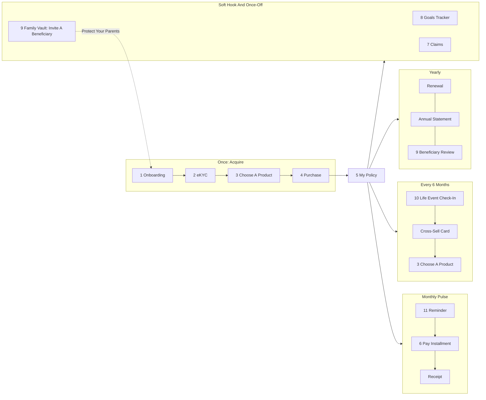

# MLI Connect App Journey Map

## The Honest Framing: A Pulse App, Not A Habit App

Life insurance is not something people want to open every day, and an app that pretends otherwise will look dead after purchase. MLI Connect is designed as a pulse app: it goes quiet for most of the month and shows up, on time and with one clear job, at the few moments that matter. Success is measured by whether those moments happen (payments made, policies kept, cover added), not by daily opens.

The target user is digital-first, will not talk to a broker, will not visit a branch, and may not be thinking about life insurance at all. The app converts demand that already exists, it does not create it. So the first product must feel small, fast and emotional, and everything after purchase must protect that policy from lapsing.

The app fixes lapse caused by forgetting and friction. It does not fix lapse caused by affordability, and we should not claim it does.

## The Cadence

| Rhythm | What Happens | Role In The Business | Flows |
| --- | --- | --- | --- |
| Daily or weekly | Almost nothing. The one soft hook is the goals tracker. | Optional engagement, never pushed hard | 8 Goals Tracker |
| Monthly | Installment payment. The reliable pulse. | Persistency and on-time payment | 6 Pay Installment, 11 Notifications, 5 My Policy |
| Every 6 months | Life Event Check-In: "Anything changed?" | The cross-sell engine | 10 Life Event Check-In, 3 Choose A Product |
| Yearly | Renewal, annual statement, beneficiary review | Retention and data hygiene | 5 My Policy, 9 Family Vault, 11 Notifications |
| Once | Purchase, and claims if they happen | Acquisition; claims is where trust is made or lost | 1 to 4, 7 Claims |

## Flow By Flow

Status key: Built means clickable today on mocked data. Planned means being built now from this design.

### 1. Onboarding (Built)

- Stage: acquire. Cadence: once.
- User goal: get in quickly without feeling committed.
- Screens: welcome (one promise, FRA licence line); language choice (Arabic or English); mobile number; OTP with an SMS preview that taps to fill.
- Emotional state: curious, a little wary ("is this legit?").
- Friction removed: no email, no password, no account form. Language is chosen first so the rest reads naturally. The OTP fills itself.
- Mocked vs real: OTP delivery and verification are mocked. Language switch and RTL are real.

### 2. eKYC (Built)

- Stage: acquire. Cadence: once.
- User goal: prove who they are without visiting a branch.
- Screens: intro explaining why the FRA requires the check (about two minutes); ID front capture; ID back capture; reading state; OCR review with extracted fields the user confirms or edits; selfie with liveness prompts (look straight, turn left, turn right, blink, smile); match confidence; Face unlock toggle; verified confirmation.
- Emotional state: cautious about sharing data, then relieved and slightly impressed when the fields come back filled in.
- Friction removed: no typing of ID data, the user only checks it. A sample image fallback means the demo never dead-ends without a camera.
- Mocked vs real: the webcam capture is real. OCR result, liveness decision and face match are mocked. No vendor is called.

### 3. Choose A Product (Built)

- Stage: acquire, and re-entry point for cross-sell. Cadence: once, then every 6 months via check-in.
- User goal: find cover that fits their life and budget without a salesperson.
- Screens: product list with three archetypes (Simple Term Life, Maash Bokra as the Savings Plan, Family Protection Plan), each with an emotional line; product calculator with age taken from the ID, cover slider (or monthly saving for Maash Bokra), term slider, and an indicative monthly premium; compare plans.
- Emotional state: hopeful, budget-conscious.
- Friction removed: age comes from the ID, the price updates as the slider moves, and the first step can be small. Every price is labelled indicative and final after review.
- Mocked vs real: pricing logic is a mocked curve. Maash Bokra savings totals show contributions only, with no projected returns.

### 4. Purchase (Built)

- Stage: acquire. Cadence: once.
- User goal: finish and be covered today.
- Screens: summary (insured, plan, cover, term, premium); payday picker so collection lands a few days after salary; beneficiary defaults to legal heirs with named people added later in Family Vault; payment method (card, Meeza, InstaPay, Fawry reference) with save-for-monthly; key terms, health declaration and finger signature; issuing state; "You're Covered" with policy number and "Tell Your Family".
- Emotional state: a small moment of commitment, then pride and relief.
- Friction removed: payday-aligned schedule set at the point of sale, saved payment method for the monthly pulse, and beneficiary detail deferred so it does not block the sale.
- Mocked vs real: payment, e-signature validation and policy issuance are mocked. Signature capture on screen is real.

### 5. My Policy (Planned)

- Stage: own. Cadence: glanced at monthly, used at yearly moments.
- User goal: know at a glance that they are covered and what is next.
- Screens: policy card with status (active, payment due, in grace, lapsed), cover amount, next installment date and amount; documents (policy schedule, receipts, annual statement); timeline (issued, payments, check-ins, changes); renewal panel at the yearly mark.
- Emotional state: reassured. The screen should take five seconds to read.
- Friction removed: no calls to ask "am I still covered?" Documents live in one place.
- Mocked vs real: policy data and documents are mocked.

### 6. Pay Installment (Planned)

- Stage: own. Cadence: monthly, the reliable pulse.
- User goal: pay in one tap and forget about it until next month.
- Screens: payment due card on the payday-aligned date; one-tap pay with the saved method and Face unlock; receipt; payment history; grace period state with clear days left; one-tap reinstatement after a missed payment; pause option for a short break (rules to confirm with the client).
- Emotional state: routine at best, anxious when late. The design should make late feel recoverable, not shameful.
- Friction removed: the date matches salary, the method is saved, approval is a glance. Missing a month has a visible, simple way back.
- Mocked vs real: payment processing, grace rules and reinstatement are mocked.

### 7. Claims (Planned)

- Stage: once, if ever. Where trust is made or lost.
- User goal: report a claim without a fight, and always know where it stands.
- Screens: claim intake (who, what happened, when); document checklist by claim type with upload; submitted confirmation with reference; status tracking (received, documents complete, under review, decision, paid) with dates.
- Emotional state: stressed, often grieving, possibly a beneficiary using the app for the first time.
- Friction removed: a clear checklist up front, uploads from the phone, and status without phone calls.
- Mocked vs real: everything behind the form is mocked. The app never adjudicates and never promises a digital decision or a payout time. Decisions stay with Misr Life's claims team.

### 8. Goals Tracker (Planned)

- Stage: own. Cadence: the only daily or weekly soft hook.
- User goal: see progress toward life goals such as marriage, a child's school fees, or a car.
- Screens: goal list; add a goal (type, target, date); goal detail with progress the user records; the policy shown as one tool supporting the goal (for example Maash Bokra toward retirement).
- Emotional state: motivated, aspirational.
- Friction removed: no spreadsheets. The policy is connected to something the user actually cares about.
- Mocked vs real: track-only, mocked. The app never holds user money and never moves money into a goal.

### 9. Family Vault (Planned)

- Stage: own and grow. Cadence: set up after purchase, reviewed yearly.
- User goal: make sure the family knows the policy exists and can act on it.
- Screens: beneficiaries (add named people, shares); documents (policy, IDs, certificates the user chooses to store); invite a beneficiary to view the policy details as a second user; "Protect Your Parents" referral prompt.
- Emotional state: responsible, caring.
- Friction removed: the classic failure where a family never knows a policy exists. A beneficiary has their own view-only access.
- Mocked vs real: storage, invites and the second user are mocked.
- Growth loop: each invited beneficiary is a new verified-ready user. "Protect Your Parents" turns that view into a purchase for someone else in the family.

### 10. Life Event Check-In (Planned)

- Stage: grow. Cadence: every 6 months, the cross-sell engine.
- User goal: keep cover right as life changes, without being sold to.
- Screens: "Anything changed?" prompt; event picker (got married, new baby, new job, bought a home, nothing changed); a tailored card per event (for example new baby leads to Family Protection Plan, new job leads to a higher cover suggestion); straight into Choose A Product with fields prefilled.
- Emotional state: reflective, open if the question feels caring and not pushy.
- Friction removed: the user does not need to know what product fits a life event. "Nothing changed" is a valid one-tap answer.
- Mocked vs real: the schedule and recommendations are mocked rules on the app's own data and the events the user declares. There is no unified cross-product customer data layer behind this.

### 11. Notifications Center (Planned)

- Stage: own. Cadence: shows the whole rhythm in one list.
- User goal: hear from the app only when it matters.
- Screens: notification list grouped by type (payment due, receipt, grace warning, check-in, renewal, annual statement, claim status, beneficiary review); preferences per type and channel.
- Emotional state: neutral to positive if volume is low and every message has a reason.
- Friction removed: one place for every reminder, with a direct action on each.
- Mocked vs real: notifications are seeded mock events. In the demo they make the cadence visible in one screen.

## Success Metrics To Pitch

These replace vanity engagement numbers such as daily active users.

| Metric | Definition | How The App Moves It |
| --- | --- | --- |
| On-time payment rate | Share of due installments paid on or before the due date in a period. | Payday-aligned dates, saved method, one-tap pay with Face unlock, reminders before the due date. |
| Persistency at month 13 | Share of policies issued in a cohort still in force 13 months after issue. | Removes forgetting and friction in the first year, when lapse risk is highest (to verify against MLI data). Grace state and one-tap reinstatement recover missed payments. |
| Persistency at month 25 | Same, 25 months after issue. | Yearly renewal moment, annual statement, beneficiary review and goals keep the policy relevant into year two. |
| Policies per user | Active policies divided by active app users. | Life Event Check-In cards, Protect Your Parents, and prefilled re-entry into Choose A Product. |
| Cross-sell conversion | Share of check-in prompts or cross-sell cards that lead to a new policy issued. | Event-specific suggestions, prefilled forms, eKYC already done so the second purchase is short. |
| Cost per acquired policy vs the agent channel | Total cost to acquire a policy through the app (media, eKYC fees, payment fees, app operations) divided by policies issued, compared with the equivalent cost through agents. | Self-serve purchase with no commission and no branch time. The comparison needs MLI's agent cost data (to verify). |

What the app will not move: lapse driven by affordability. If a customer cannot pay, a better reminder does not fix that. The pause option and grace period soften it, they do not solve it.
