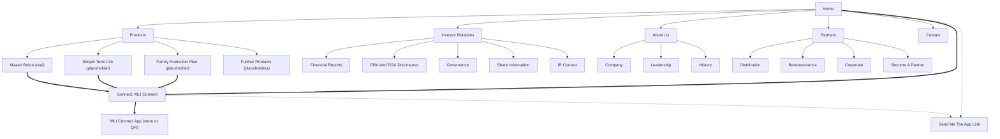

# Sitemap And Page Purposes

Two surfaces share one domain and one design system:

- The main website: traditional, trust-first, calm. Layout and flow follow the structure of lemonade.com (short sections, one idea per band, a clear next step), not its art direction. It has no buy button and shows no premiums.
- The MLI Connect landing page at `/connect`: the younger, modern face, in the spirit of ladderlife.com. One clear action: get the app.

Core navigation: Products, Investor Relations, About Us, Partners. Contact sits in the header utility area and the footer. The primary CTA on every page is "Get MLI Connect", which points to `/connect`.

## Sitemap Diagram

Thick arrows are the "Get MLI Connect" funnel. Dotted arrows are the window-shopper capture.

## The Get MLI Connect Funnel

1. Any page on the main site carries "Get MLI Connect" in the header and at the end of every product section.
2. The CTA lands on `/connect`, which does one thing: get the app onto the visitor's phone.
3. On desktop, `/connect` shows a QR code that opens the right store on the phone. On mobile, it shows the App Store and Google Play badges.
4. Inside the app, the visitor verifies identity (with the facial check the FRA requires), picks cover and buys.

The website never asks for payment, never shows a premium, and never makes the visitor feel they missed a buy button. Each product page explains why buying happens in the app: a quick face check keeps the policy safe and is required for buying online.

## Send Me The App Link (Window-Shopper Capture)

For visitors who are curious but not ready to install now.

- Fields: mobile number, and a choice of WhatsApp or SMS. Nothing else.
- Placement: on `/connect` under the QR, in the footer of every page, and at the end of each product page.
- Message: a single link to the right store, plus one line about what the app does. Consent to receive the link is stated in one line next to the button.
- In the demo the send is mocked and shows a confirmation state.
- Why it matters: the target user may not be thinking about life insurance today. A link sitting in their WhatsApp is a second chance at the moment they are ready. It is also the cheapest lead the site can collect.

## Page By Page

Each page lists: Purpose, Primary Audience, The One Action, Key Content Blocks, CTA.

### Home

- Purpose: establish trust in a few seconds and route each visitor to the right place.
- Primary audience: prospective customers, existing policyholders, and investors looking for IR.
- The one action: go to `/connect` and get the app.
- Key content blocks: hero with a plain promise and "Get MLI Connect"; FRA licence and ownership line; product overview cards (no prices); how buying works in three steps (download, verify, choose cover); the MLI Connect teaser with phone visual; claims and service reassurance; Investor Relations entry band; Send Me The App Link; footer with regulatory text.
- CTA: Get MLI Connect. Secondary: Explore Products, Investor Relations.

### Products (Index)

- Purpose: show every product Misr Life offers, grouped by need, so the visitor can find their fit.
- Primary audience: prospective customers comparing options.
- The one action: open a product page.
- Key content blocks: need-based filters (protect my family, save for later, cover for my business); product cards with name, one-line benefit, who it is for, and a "Buy in MLI Connect" or "Talk to us" marker; a note that prices are shown in the app; help choosing (link to Contact).
- CTA: View Product. Global: Get MLI Connect.
- Note: products available in the app carry a small "Available in MLI Connect" tag. Products sold through other channels route to Contact or Partners.

### Product Detail (One Page Per Product)

Products: Maash Bokra (real MLI product, the Savings Plan archetype). Simple Term Life and Family Protection Plan (placeholders, the other two app archetypes). Further placeholder products to show the full range, for example group and corporate cover.

- Purpose: explain one product clearly enough that the visitor decides to start in the app.
- Primary audience: a prospect who has narrowed down to this product.
- The one action: Get MLI Connect to buy (app products) or request a call-back (others).
- Key content blocks: what it is in one sentence; who it is for; what you get (benefits, no prices); how it works in steps; eligibility basics (age range, term range) where known; what is not covered in plain language; FAQ; documents (product brochure placeholder); "Why do I buy in the app?" explainer.
- CTA: Get MLI Connect. Secondary: Send Me The App Link.

### Investor Relations (Index)

- Purpose: give investors, analysts and regulators one reliable place for disclosures and company information. Mirrors the structure of the current misrlife.com IR section, reskinned (structure to verify against the live site).
- Primary audience: investors, analysts, journalists, the FRA and EGX.
- The one action: find the latest disclosure or report.
- Key content blocks: latest announcements; key documents pinned; links to the five sub-sections; financial calendar; IR contact strip.
- CTA: View Latest Disclosures.
- Tone: no marketing. No "Get MLI Connect" in the IR body, only in the global header.

### Financial Reports

- Purpose: publish annual and interim financial statements and board reports.
- Primary audience: investors and analysts.
- The one action: download a report.
- Key content blocks: filter by year and type; annual statements with notes; quarterly statements; board report; auditor report; investor presentations. All documents are placeholders for the demo.
- CTA: Download (per document).

### FRA And EGX Disclosures

- Purpose: show regulatory and exchange disclosures, dated and complete.
- Primary audience: regulators, investors, compliance teams.
- The one action: open a specific disclosure.
- Key content blocks: disclosure list with date, type and source (FRA or EGX); search and filter; regulatory status line; archive.
- CTA: View Disclosure.

### Governance

- Purpose: show who governs the company and by what rules.
- Primary audience: investors, regulators, journalists.
- The one action: read the board and committee information or a governing policy.
- Key content blocks: board of directors; board committees; governing policies (board charter, code of conduct, related-party policy); general assembly records; last-updated date on each section.
- CTA: Download Policy.

### Share Information

- Purpose: share data and ownership structure.
- Primary audience: shareholders and analysts.
- The one action: check share data or ownership.
- Key content blocks: listing status; share price with delayed timestamp (placeholder); ownership structure; dividend history; shareholder register contact.
- CTA: Contact IR.
- Note: earlier material describes Misr Life as preparing to list on EGX (to verify). If the company is not listed at demo time, this page shows listing status and ownership only, and the price module stays hidden. Legal should confirm wording for the quiet period.

### IR Contact

- Purpose: give investors a direct line to the IR team.
- Primary audience: investors, analysts, journalists.
- The one action: send an inquiry to IR.
- Key content blocks: IR team contact details (placeholder); inquiry form (name, organisation, email, topic, message); alert sign-up for new disclosures.
- CTA: Send Inquiry.

### About Us (Index)

- Purpose: answer "who is behind this and can I trust them".
- Primary audience: prospects doing a trust check, candidates, press.
- The one action: move on to products or the app with more confidence.
- Key content blocks: one-paragraph company story; three facts (founding year, ownership, regulator) each with a source; links to Company, Leadership, History.
- CTA: Get MLI Connect.

### Company

- Purpose: describe what Misr Life is today: life arm, ownership, regulation, mission.
- Primary audience: prospects, partners, press.
- The one action: understand the company's standing.
- Key content blocks: mission; ownership (Misr Insurance Holding, under the Sovereign Fund of Egypt, to verify); FRA licence details; what the company offers; the digital direction, including MLI Connect.
- CTA: Get MLI Connect. Secondary: Partners.

### Leadership

- Purpose: put names and faces on the company.
- Primary audience: investors, partners, press.
- The one action: see who leads the company.
- Key content blocks: executive team and board chair with photo placeholders, title and short bio.
- CTA: Investor Relations (Governance).

### History

- Purpose: turn heritage into a promise that the company pays when it matters.
- Primary audience: prospects, press.
- The one action: feel the company's long track record.
- Key content blocks: timeline from founding (1900, to verify) to the transformation and MLI Connect; milestones as placeholders where dates are unknown.
- CTA: Get MLI Connect.

### Partners (Index)

- Purpose: show the B2B side and route each partner type to the right team.
- Primary audience: banks, brokers, agents, employers.
- The one action: pick a partner path.
- Key content blocks: four cards (Distribution, Bancassurance, Corporate, Become A Partner); partner logos (placeholders).
- CTA: Become A Partner.

### Distribution

- Purpose: explain how brokers and agents work with Misr Life.
- Primary audience: licensed brokers and agents.
- The one action: start a distribution partnership inquiry.
- Key content blocks: who qualifies; what partners get (products, training, tools); how to verify a licensed agent (anti-fraud).
- CTA: Become A Partner.

### Bancassurance

- Purpose: explain the bank partnership model.
- Primary audience: banks and their teams.
- The one action: contact the bancassurance team.
- Key content blocks: how bancassurance works; current bank partners (placeholder, for example NBE, to verify); integration options.
- CTA: Talk To The Bancassurance Team.

### Corporate

- Purpose: present group life and employee benefits.
- Primary audience: HR and finance leads at employers.
- The one action: request a group quote call.
- Key content blocks: group life overview; who it suits; how onboarding works; FAQ.
- CTA: Request A Call.

### Become A Partner

- Purpose: capture partner leads with enough detail to route them.
- Primary audience: any prospective partner.
- The one action: submit the partner form.
- Key content blocks: short form (organisation, partner type, contact, message); what happens next and response time.
- CTA: Submit.

### Contact (Intent Capture)

- Purpose: capture intent from anyone who wants a person, and route it.
- Primary audience: prospects who want help, existing customers, partners.
- The one action: tell us what you need.
- Key content blocks: intent picker (I want cover, I have a policy, I need to claim, I am a partner, Media, Investor); short form per intent; hotline and branches (placeholders); Send Me The App Link for anyone who wants to self-serve; complaints route.
- CTA: Send. Secondary: Get MLI Connect.

### MLI Connect Landing Page (/connect)

- Purpose: get the app onto the visitor's phone.
- Primary audience: prospects arriving from the main site, ads or WhatsApp links.
- The one action: install MLI Connect.
- Key content blocks: hero with phone visual and one line; QR code on desktop, store badges on mobile; how it works in three steps; product teasers for the three app archetypes (no prices); what you can do after buying (pay, track, family vault, claims status); trust strip (FRA licence, Misr Life parent, data privacy); FAQ (why the face check, is my data safe, can I buy for my parents, what if I miss a payment); Send Me The App Link.
- CTA: Get The App (QR or store badge). Secondary: Send Me The App Link.
- Design: the younger, brighter MLI Connect look, but with the same wordmark, type and ink as the parent site so it reads as the same company.

## Footer (Every Page)

Products, Investor Relations, About Us, Partners, Contact, Get MLI Connect, Send Me The App Link, language switch, FRA licence line, privacy and terms links (placeholders).
